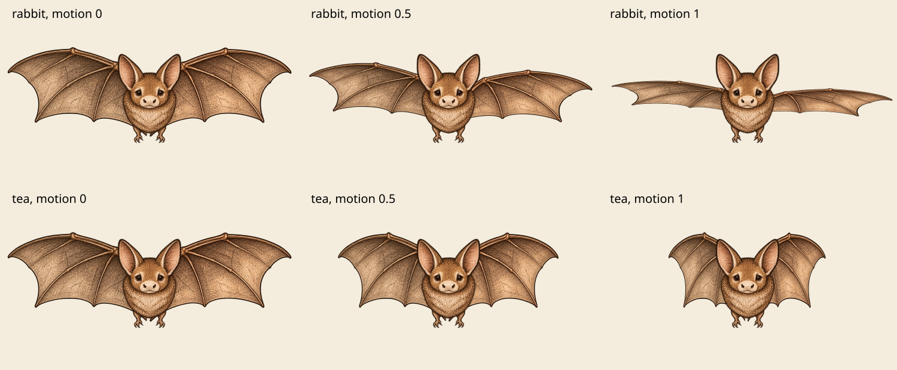
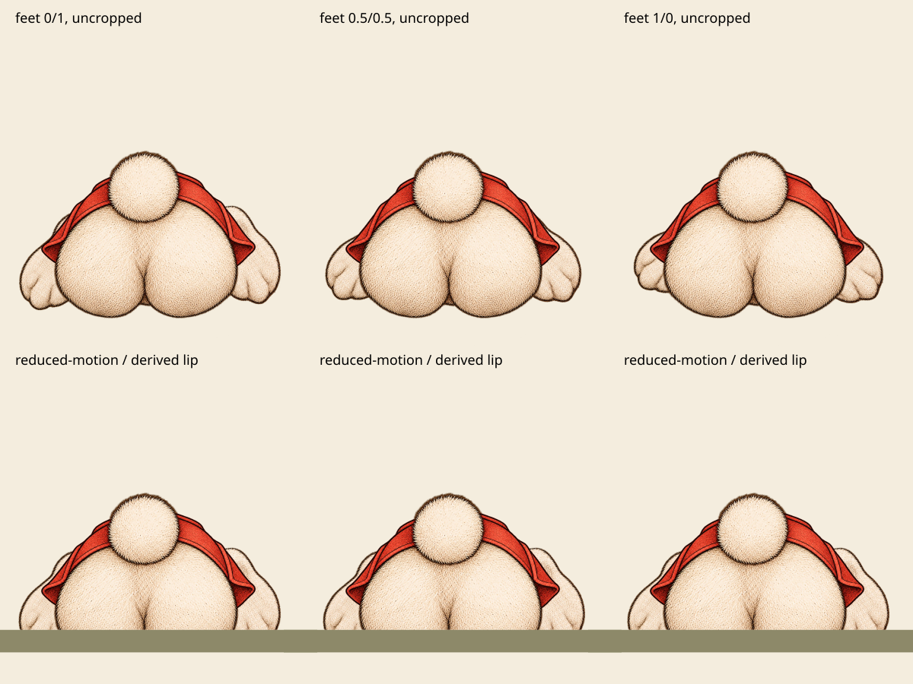

# Bat and diving Rabbit generated motion checkpoint, 2026-10-21

Status: six generated layers, static composition and automated source contracts
prepared. Browser scene rendering remains unverified. This is not production
approval and does not mark the image work as finished.

## Scope and integration

`generatedBatDivingSvg(id, style, demo)` returns a complete SVG for:

- `bat`, `engraved`, `rabbit-hole` or `tea-party`.
- `white-rabbit/diving`, `engraved`, `riverbank`.

Flat, paper, unknown-scene and other identities return `undefined`, preserving the
existing renderer. Both HTML `figure` and SVG `svgFigure` use the same adapter.
The roots explicitly retain 100 × 50 and 100 × 100 dimensions and viewBoxes. CSS
is imported only by the runtime `generated-rig.ts`, never by the art adapter that
Vite's build configuration imports.

The two original motion hooks each exist once. Each contains an original vector
fallback and one initially hidden raster layer; the body also has a complete
fallback. All three images must decode before any generated part becomes
visible. A failed or delayed part leaves the complete original artwork, including
its original fill-box geometry. The original Bat tea-tray overlays remain outside
the Bat rig, and the diving Rabbit's existing burrow, hole lip and placement CSS
are untouched.

## Source QA and maps

All eight supplied inputs were inspected: Bat master and three parts, corrected
diving Rabbit master and three parts. The initial diving master with cat-like paw
pads is not shipped. The accepted hind-foot layers have fur-covered soles without
those pads; the diving actor shows no head, face or ears.

Equal canvas sizes did **not** mean that generated parts kept the master's
alignment. Each layer therefore uses an explicit uniform SVG map, in source-pixel
to original-scene units. No generated pixel cleanup was performed.

| Layer | Uniform scale | Translation |
| --- | ---: | --- |
| Bat body | 0.0385 | 15.8505, 5.8 |
| Bat left wing | 0.05 | 2, 0 |
| Bat right wing | 0.044 | 21, 1 |
| Diving body | 0.07 | 4.15, 32 |
| Diving left foot | 0.065 | 1, 20 |
| Diving right foot | 0.075 | 6, 10 |

All Bat canvases are 1774 × 887; all diving canvases are 1254 × 1254. Very faint
source alpha away from the main silhouettes is retained and included in the full
alpha bounds. The provenance also records bounds above alpha 32 so that the two
measurements are not confused.

### Bat motion

Rabbit Hole retains its view-box pivot (50, 25), `rh-flap` scaleY 1 to 0.35 and
rotation 0° to 8°, and the right-wing 0.05 s delay. Tea Party retains `tp-flap`
scaleX 1 to 0.55, with ready-only mapped inner-wing pivots (49.3, 20.8) and
(50, 20.8). These are explicit generated-art pivots, not a claim that transparent
canvases reproduce the original vector fill-box. Existing pause and reduced-motion
rules continue to address the same hooks.

This contact sheet was rendered from the adapter's SVG markup and shipped WebP
layers with the relevant motion transforms materialized as SVG transforms. It is
not a browser screenshot. Independent visual review found connected wing roots
through both sampled scene motions, without floating membranes or duplicated
limbs.

### Diving foot motion and crop

The original outer ellipses have rx 9, ry 17 and rotations ±34°. Their default
fill-box half-height is sqrt((9 sin 34°)² + (17 cos 34°)²), or
14.965262634356097. The smaller inset ellipses stay inside that box. The original
50% 90% pivots therefore resolve analytically to (22, 91.97221010748488) and
(78, 91.97221010748488), excluding stroke.

Ready raster parts explicitly use those view-box coordinates. Switching boxes
also changes percentage translations, so the ready-only animation preserves the
original travel as numeric values: 4% becomes 1.1972210107484877 units and −6%
becomes −1.7958315161227316 units. Rotations −10° to 12°, 0.42 s alternating ease,
the right-foot −0.21 s delay and pause remain unchanged. Reduced motion keeps the
original asymmetric settled pose: left −10° with no translation, right 12° with
the preserved upward translation.

The top row shows uncropped extrema and midpoint. The lower row repeats the
reduced-motion pose with a schematic lip at y=91.5625. That crop is derived from
the unchanged burrow height 0.9 × width, Rabbit width 64% and bottom −6%:
100 × (1 − 0.06 × 0.9 / 0.64). The green strip is a proof illustration, not a
replacement for the scene's actual hole. Main foot alpha stays within x≈4.05 to
97.06 across the sampled extrema; the rump intentionally extends below the lip.
Independent review found no blocking joint or fallback defect in either rig.
Actual browser `getBBox`, responsive crop and the full field composition remain
to be verified rather than assumed from these calculations.

## Provenance and bytes

`src/assets/images/generated-layers/bat-diving-provenance.json` records source and
shipping SHA-256 hashes, dimensions, alpha hashes/bounds, source intent, rejected
master identity and encoding. Exact prompts, seeds and model versions were not
available to the integrating worker and have not been invented.

Delivery uses WebP quality 92, method 6. All six files retain exact original
canvases and exact alpha bytes. There was no crop, resize, recolour or cleanup.

- Bat body / left wing / right wing: 199,196 / 197,126 / 257,250 bytes.
- Diving body / left foot / right foot: 340,774 / 93,596 / 75,308 bytes.
- Added runtime image payload: 1,163,250 bytes total. Bat consumers add 653,572
  image bytes; Riverbank adds 509,678 image bytes. These are asset totals, not
  measured first-viewport network cost. Review PNGs are documentation assets.

## Verification and remaining checkpoint

- Initial red run: six missing adapter/file contracts failed, one existing scene
  preservation contract passed.
- Focused generated Bat/diving plus atomic rig tests initially passed 12/12.
  Final focused run including the shared renderer integration and existing art
  tests passed 19/19.
- TypeScript check passed on the shared working tree after these files were added.
- Biome checks passed for this worker's module, CSS, tests and provenance.
- A full suite started before coordination requested waiting for the parallel
  Alice pose hookup: 525 passed, 10 failed, all in
  `generated-alice-poses.test.ts`. This was not reported as a full green gate;
  the coordinator owns the later aggregate run after all adapters are integrated.
- `tests/play/generated-bat-diving.spec.ts` prepares normal/reduced motion,
  unique hooks, explicit origins, pause, each failed image, delayed atomic reveal,
  original fallback foot `getBBox`, tray presence and burrow overflow checks.
- Browser execution was not attempted under the current restriction. No browser
  rendering, motion timing, actual scene crop or full end-to-end pass is claimed.
- The worker made no commit, push, PR change, CI trigger, merge or deployment.
