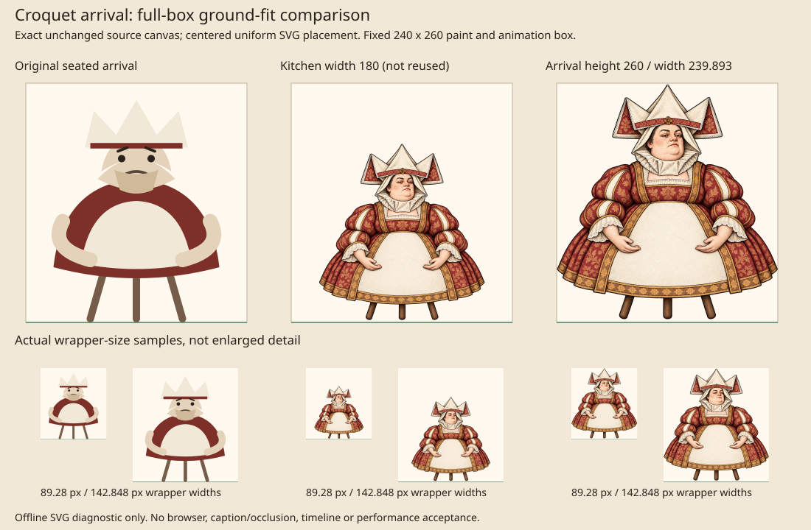

# Duchess Croquet arrival checkpoint

The seated generated Duchess is now also scoped to engraved **Croquet's late
arrival**. The existing Pig and Pepper fit is unchanged. This is a provisional
static composition checkpoint, not owner art approval or browser acceptance.

## Why this consumer can share the seated master

Croquet inserts `figure('duchess')` into `.cq__duchess` in `main.ts`. Its entrance
changes only the outer `--in` value; `croquet.css` maps that to
`translateX((1 - --in) * 40vw)`. There is no baby, hand support, shoulder contact
or independently animated body part in this consumer. The original SVG is
itself a seated figure on three chair supports. Its late arrival does not claim
a walking gait.

The adapter retains the same fixed 240 × 260 paint/animation rectangle and the
full original fallback. The one reused image is hidden until atomic decode.
Flat/paper, unscoped calls and the separate Duchess walking chapter stay original.
The scene's entrance, timing, reduced-motion duration and visibility remain intact.

## Separate arrival fit

A visual comparison rejected blindly reusing the kitchen's width 180 fit: its
lap support is intentional there, but needlessly shrinks this standalone arrival.
The selected uniform scale is 260 / 1306; the complete original 1205 × 1306 canvas
therefore occupies width 239.8928024502, height 260, x 0.0535987749, y 0.
No source pixels are cropped, rescaled in storage, repainted or regenerated.

The source's visible alpha above 16 ends at y 1289, about 3.38 logical pixels
above the box baseline after fitting. This small source margin is retained,
not removed to manufacture exact foot contact. At the sampled 89.28 px and
142.848 px wrapper widths it is about 1.26 px and 2.01 px respectively. The image
shows all three chair supports without anatomical clipping.

The small samples are offline SVG reconstructions of wrapper widths derived
from `--cq-cat: clamp(9rem, 30vmin, 18rem)` and the Duchess factor 0.62, assuming
a 16 px rem. They do not reproduce complete scene occlusion, captions, browser
filters or entrance playback. Those remain review checkpoints.

## Evidence and limits

- Reuses `figures/duchess--seated.any.generated.webp`, 434,224 bytes; **zero new
  runtime image bytes**. Existing source encoding and exact-alpha record remain
  in `seated-duchess-provenance.json`.
- Seven focused contracts pass after the new consumer/scope expectations failed
  before implementation: fallback, kitchen fit, arrival fit, exclusions,
  cross-scene paint-ID uniqueness, provenance and both public rendering routes.
- No aggregate gate, CI, browser, performance budget, push or commit was run
  for this focused change. Parent integration verification remains separate.
- The earlier kitchen contact review remains valid for its kitchen-specific fit;
  its original kitchen-only scope statement is superseded by this addendum.
