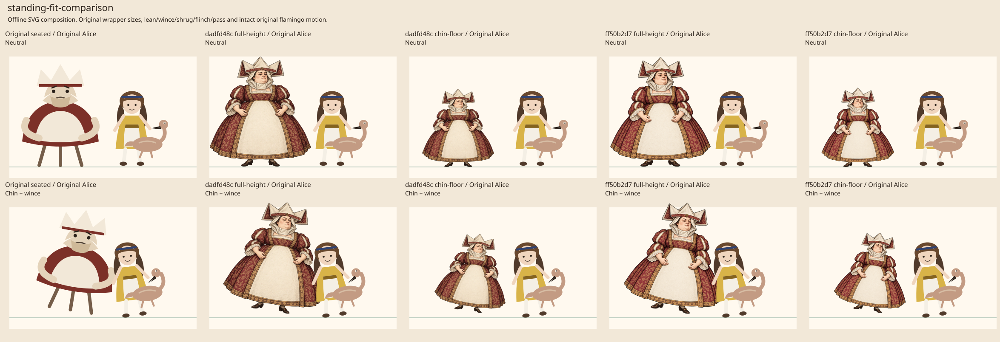
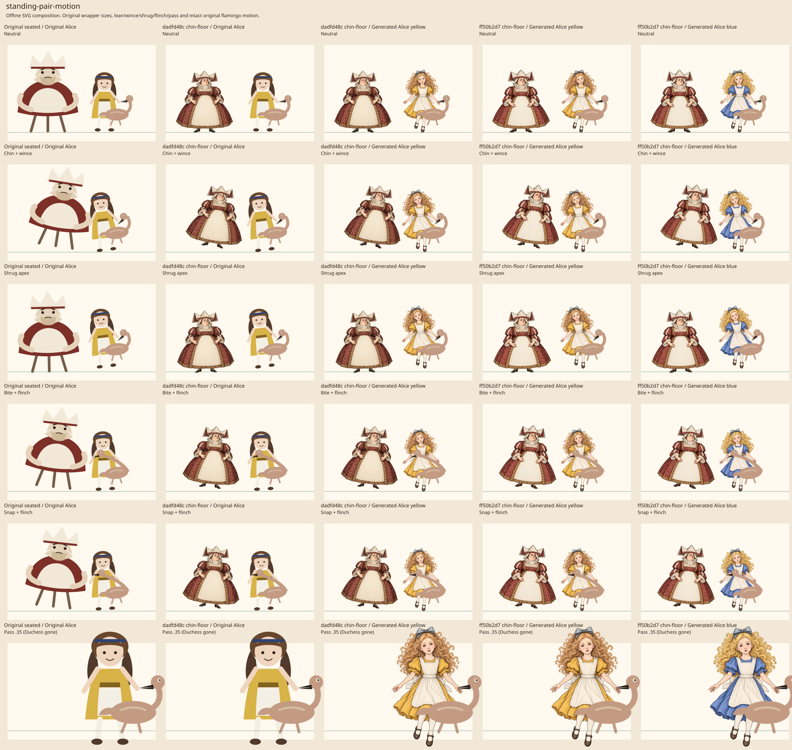

# Duchess standing composition checkpoint

The existing standing Duchess sources were re-evaluated separately from the
seated kitchen master. The old pixel coordinates are not themselves an art
acceptance requirement. This checkpoint distinguishes inherited unproven contact
from a new compositional regression.

The selected provisional runtime composition uses the existing `dadfd48c` WebP
through `generatedWalkingDuchessSvg`, for engraved Duchess chapter only. It adds
no image bytes. Kitchen and Croquet continue using the separate seated source.
Original Alice and the original live flamingo remain unchanged.

## Two intact sources, two uniform fits

- `dadfd48c`: the already encoded `figures/duchess.any.generated.webp`,
  1205 × 1305. Source PNG SHA-256
  `cfda472817167c7771ff287278d120c0740e717b643c84c3750a54626d2e3fd1`.
- `ff50b2d7`: existing PNG revision, 1205 × 1306. Source SHA-256
  `44762126cacdf0cfad4e1544dc2c0eaa07a93c574a3eac5a2b794ed062e17f4c`.
  It was not encoded or installed by this review.

Both are naturally standing, wide-dressed figures with intact shoes. No new image
generation, limb extraction, repainting or source-image reshaping was attempted.
Full-height placement moves the chin far above the old approximate chin height.
An alternate uniform scale keeps the approximate chin at (120,120) and the
lowest visible foot near y 260 without stretching the body:

- `dadfd48c`: source chin approximately (640,310), foot y 1299; scale
  140 / (1299 - 310), x 29.4034378160, y 76.1172901921, width 170.5763397371,
  height 184.7320525784.
- `ff50b2d7`: source chin approximately (645,330), lowest alpha above 32 at
  y 1301; scale 140 / (1301 - 330). Full numeric placement is recorded in
  `duchess-standing-composition-20261021.json`.

Chin landmarks are visual estimates, approximately ±15 source pixels, not an
anatomical keypoint detector. Source alpha bounds and canvas dimensions are
measured. The fixed 240 × 260 reference box stays unchanged in the reconstruction.
The source canvas extends about 0.85 logical units below the fixed paint floor.
The foot row 1299 is the floor anchor; remaining rows 1300–1304 have maximum alpha
7/255. These faint padding pixels are outside the fixed paint rectangle, rather
than expanding the scene box. The source bytes and canvas are unchanged.

## What the motion comparison actually establishes

The six reconstructed states are neutral, lean plus wince, shrug apex, full bite
plus flinch, bite snap plus flinch, and Alice's pass at 0.35 after the Duchess is
gone. Both generated Alice colours are included diagnostically, not enabled.
The original flamingo SVG and its neck/head/jaw transforms are unchanged.

Original CSS sizes are used: Duchess 240 × 260, Alice 115.2 × 192 at
(230.4,68), and flamingo at Alice-local (36.864,69.12), width 126.72. The existing
Duchess lean/near/shrugged/flinch and Alice wince/shrug-up/pass formulas are
applied to those wrapper boxes. This is static composition, not real CSS/GSAP
playback. Walking bob phase, reverse scroll, full-stage captions and clipping,
filters, reduced-motion event timing and pause behavior are not certified.

The standing-Duchess-only fit remains anatomically coherent through these
samples. No new penetration or disconnected limb was observed, and the original
Alice/flamingo relationship stays unchanged. The smaller overall Duchess
silhouette is a visual checkpoint, not itself a functional blocker. Independent
review agreed with that distinction.

The original seated fallback also fails to establish literal chin-to-shoulder
contact in this reconstruction. Using its approximate logical chin (120,120)
and Alice shoulder (40,74), lean=1 and wince=1 leave a distance of about 102.8
logical units. A standing fit preserving that chin location inherits the same
unproven contact; it neither solves it nor introduces it. Merely matching chin
height is not proof of contact. Moving a whole intact source far enough to force
literal contact at the unchanged floor would carry its right edge to about x 290,
outside the fixed 240-wide box, so that is not a valid contact repair.

## Generated falling Alice stays excluded

With the current generated falling Alice whole pose, the same original flamingo
bite overlaps the upper chest/neck region rather than the original shoulder-area
composition. The broad hair, shoulder and forearm silhouettes also do not
establish a newly proven tucked hold. This is an observed new composition risk,
not a rejection for failing to match the old prototype exactly.

Accordingly, neither generated falling Alice colour is enabled for the Duchess
chapter, and no refused leg/neck/other part generation was retried or reconstructed.
A future Alice contact correction needs a coherent whole-pose hold and bite
composition; swapping isolated body parts to mask the mismatch is not established.

## Verification

Six focused adapter tests cover the original atomic fallback, exact uniform
placement in the fixed box, scene/style exclusions, unique paint IDs and the
existing asset hash plus provisional limitations, and both public rendering routes.
The 21-test focused set also includes seated Duchess, falling Alice and tucked
Flamingo exclusions. The broader six-file focused set, including generated-prop
and generated-source regressions, passes 72 tests. New
behavior was observed failing before implementation, then passing. Scoped Biome
checks pass. Full aggregate and browser verification are separate parent gates;
none is claimed by this static checkpoint.
