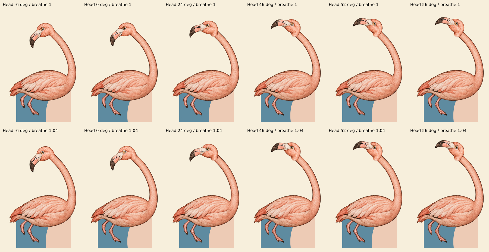

# Flamingo generated motion checkpoint, 2026-10-21

Status: croquet source composition and structural tests reviewed; browser rendering
and interactive scene QA remain unverified. This is not production approval.

## Scope and fallback

- `generatedFlamingoSvg(id, style, demo)` opts in only `flamingo`, `engraved`,
  `croquet`. The shared figure renderer owns this integration. Its CSS is loaded
  through the runtime-only generated-rig entry, not from the renderer module used
  by the static index build.
- The original 300 × 420 viewBox and original Alice dress/skin token paths remain
  live, so blue and yellow variants are not baked into the bird.
- Both generated parts are hidden until both decode successfully. One failed or
  pending part leaves the complete original body, head, eyes and hands visible.
- The original body and head hooks exist once in SVG definitions. The original
  head instance remains a sibling of the body. Only the generated head instance
  nests under body breathing, avoiding a separating neck joint.
- Flat, paper, unknown-scene and tucked/Duchess consumers retain their originals.
  The tucked master alone cannot replace independently moving neck, head, jaw and
  pointer-following pupil parts. No Duchess behavior was changed.

## Source correction and geometry

The original head cut-out, `exec-6bbaab92-ebcc-46e7-9068-87e4f09965ad.png`, retained
an elongated short-neck stump. At joint rotations from 24° to 70° it dangled below
the head. That source was rejected and replaced through image generation by
`exec-8a9ad345-5073-469c-8214-e02aa7acbb98.png`. No hand cleanup was applied.

Both accepted parts retain their original 1060 × 1484 canvases, placed uniformly
into the 300 × 420 SVG. The measured source overlap is approximately (650, 310),
which maps to (183.962264, 87.735849). Both source alpha samples at that point are
253. Body and head use the identical canvas mapping.

The ready-only head rotation replaces the old vector's 150° skew/translation.
The long neck belongs to the body, not to this separate head. Runtime poses use:

- Mood: 0° to 52°, with a stroke nod subtracting up to 6°.
- Looking/puzzled: 52°, plus pointer movement up to ±4° and the same nod.
- Reduced motion: settled content 0°, wary 24°, sulking/puzzled 52° cuts.
- Breathing: the existing body animation scales Y from 1.00 to 1.04; its generated
  head instance follows the same parent transform. Existing pause and whole-bird
  swing/runaway/catch consumers are retained.

The static composition below was rendered from unchanged PNG image elements and
SVG transforms. It samples −6°, 0°, 24°, 46°, 52° and 56°, each with breathing at
1.00 and 1.04. The corrected overlap stays connected in these samples. Independent
review confirmed removal of the dangling stump and no concrete new composition
blocker. This contact sheet is not a browser screenshot, and it does not prove
browser CSS inheritance through SVG `use` instances.

## Provenance and byte budget

`src/assets/images/generated-layers/flamingo-provenance.json` records exact source
and delivery hashes, dimensions, alpha bounds, alpha hashes, rejected-source
identity, and encoding. Exact generation prompts and seeds were unavailable to
the integrating worker and are not fabricated.

Delivery uses WebP quality 92, method 6. Dimensions, full canvas and exact alpha
bytes were verified unchanged from the supplied PNGs. No crop, resizing,
recolouring or cleanup was performed. Very faint source alpha outside the main
silhouette is preserved and reflected in the recorded full alpha bounds.

- Body: 191,940 bytes.
- Corrected head: 40,090 bytes.
- Added production image payload: 232,030 bytes total. The review PNG is a
  documentation artifact, not runtime image payload.

## Verification

- A red test run first demonstrated six missing implementation contracts.
- Focused Vitest run: 14/14 passed across generated Flamingo and atomic rig tests.
- TypeScript check passed for the current shared working tree.
- Biome check passed for this worker's TS, CSS, test and provenance files.
- Browser contract tests are prepared in `tests/play/generated-flamingo.spec.ts`:
  normal/reduced motion, English/Japanese, blue/yellow hands, unique hooks, pause,
  actual rendered mood change and reset, each failed part, and delayed atomic load.
- Browser execution was not attempted under the current restriction. Browser
  `use`-instance inheritance, pause behavior, pointer motion, swing/escape/catch,
  and full scene composition still require the permitted browser gate.
- The coordinating task owns the full shared test/build gate. No commit, push,
  PR mutation, merge, CI trigger or production change was made by this worker.
