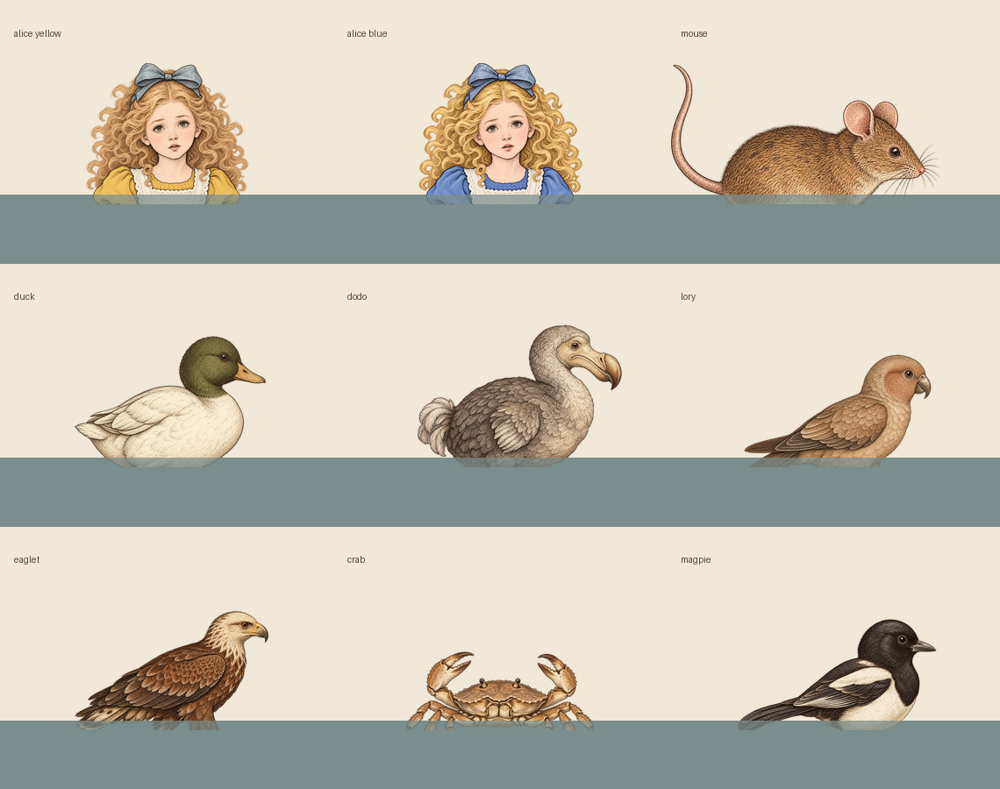

# Pool of Tears swimming illustration checkpoint

Date: 2026-10-21. Status: integrated candidate, source/composition reviewed;
browser motion, performance and owner art acceptance remain pending.

## Actual render path

The eight swimmers are painted directly by `pool-of-tears/sea.ts`, not by the
`alice/swimming` registry placeholder. `generated-swimmers.ts` now supplies
decoded pictures inside that existing Canvas transform. It does not change the
registry, shared figure renderer, swimmer state, shore transition, or timeline.

- The Duck, Dodo, Lory, Eaglet, Mouse, Crab and Magpie reuse their existing
  generated runner cutouts. Their natural upper-body silhouettes fit the water
  once legs are submerged; seven additional generated files are unnecessary.
- Alice uses two dedicated head-and-shoulders cutouts, not a standing sprite.
  Yellow and blue both have 1254 × 1254 canvases. Alpha >32 bounds are
  (55, 43)–(1208, 1151) and (53, 43)–(1209, 1153), respectively. Both eyes remain
  comfortably above the cut, approximately at source (575, 506) and (741, 477).
- Alice's source waterline is y=975, with centre x=630 and uniform scale 72/1254.
  The bottom of the source canvas is transparent padding, not the waterline.
  Head, neck and upper shoulders therefore remain visible without floating the
  whole chest above the surface.
- Animal origins, waterlines, scales, dimensions, exact file hashes and existing
  provenance references are recorded in
  `src/assets/images/swimming-provenance.json`.
- Delivered pixels were not cropped, resized, recoloured or cleaned. The two new
  WebPs use quality 92 / method 6 encoding, with original canvas dimensions and
  alpha verified byte-for-byte. Existing animal files are unchanged.

## Motion and loading contracts

The existing translate, surface-slope rotation, direction reflection, visibility
alpha, zoom, drift, offset and homing remain outside the image adapter. The
foreground water is still painted after all swimmers. A four-local-unit strip
below the measured waterline renders at 28% alpha.

The source cut follows the existing jump and entrance displacement. The Mouse's
leap therefore reveals its complete body and paws, rather than lifting a sliced
torso out of the water. Nine independently drawn bristles follow measured points
on the Mouse's generated back and retain the existing bristle intensity.

Each selected URL is loaded and decoded once, including cached failures. The
scene starts immediately with its original procedural swimmers; successful
decode switches one complete character at a time. Error/invalid decode leaves
that original drawing in place. No image or promise is created per swimmer per
frame, and no new frame loop or timer is added. Appearance changes invalidate
old callbacks; detached canvases cannot receive late publication. Flat/paper
rendering remains procedural and initiates no generated swimmer fetches.

## Source-composition review

This disposable contact sheet renders the actual exported placement data from
the unchanged WebP sources. It is not a browser screenshot and does not establish
Canvas/WebP rendering, real water-wave contact, timing, responsive legibility or
frame performance. All seven animal upper-body cuts read as floating rather than
standing; the Mouse keeps its existing curled tail. Alice's shoulder/collar
silhouette and both variant faces are preserved.

An independent static code and composition review found no blocking issue in
waterline placement, leap/bristle behavior, outer transforms, foreground order,
late decode/appearance handling or procedural fallback. The existing GSAP draw
ticker remains responsible for painting, including a late decode while the
simulation is paused; actual pause playback is still a browser checkpoint.

## Verification and remaining checks

- Focused Vitest: 12/12 passed, including actual `createSea` draw-command tests,
  all eight image routes, uniform scaling/waterline cuts, leap reveal, bristles,
  pending/error/rejected decode, shared URL caching, palette changes, detach,
  transforms, foreground ordering and exact delivery provenance.
- Typecheck, repository lint, data checks and production build passed during this
  integration pass. The build retains its existing large-chunk warning.
- An earlier full-unit run encountered 10 concurrent Alice-pose routing failures
  outside this change. Those shared hooks were subsequently wired by their owner;
  the coordinating task owns the final aggregate run after all files stabilize.
- `tests/play/generated-swimming.spec.ts` adds 11 Chromium-desktop contracts:
  both languages, both motion preferences, both Alice variants, phone resize,
  reverse visits, failed-image fallback and flat/paper retention. They typecheck
  and `--list` discovers all 11, but none was browser-executed here. The existing
  browser restriction was not retried or bypassed. No CI was dispatched.
- Still check actual scene water contact through lean/ripple/entry/jump, tiny
  phone faces, pause/resume, shore transition and renderer frame cost. New art
  may proceed independently; these are review checkpoints, not a human blocker.

## Payload

Two new shipping images total 1,143,746 bytes: yellow 662,394 B and blue 481,352 B.
Only the selected Alice variant is fetched. Seven existing animal assets total
2,082,194 B; they add no new asset files and reuse URLs already used by the shore
party. The preload is non-blocking, but these bytes are not claimed to be lazy or
to meet the story's image budgets. The Pool demo is outside those story budgets
under `performance-budget.md`; production optimization and browser frame evidence
remain separate. The review PNG is documentation only and is not bundled.

No commit, push, merge, production deployment or permission change was performed
by this integration task.
