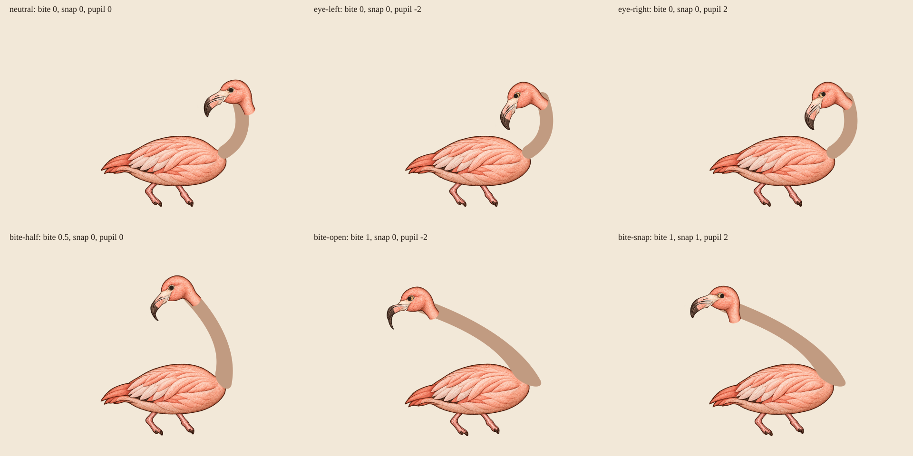

# Tucked Flamingo: hybrid rejection checkpoint

Inspected 2026-10-21 against `3bbf062`. This is a source/composition checkpoint,
not a completed generated rig, browser pass, or owner art approval.

## Result

The original `flamingo/tucked` actor stays intact. Three generated part candidates
(body, head and lower jaw) were inspected and composed with the exact original
SVG neck. The six-state hybrid is not visually coherent, so no partial replacement
or new renderer is installed. Runtime asset bytes added: **0**.

The raster neck request returned no output after refusal. It was not retried,
extracted from the master, redrawn, textured, recoloured, or recreated another way.
The existing SVG neck is unchanged. Its normal colour token was resolved only for
an offline diagnostic render.

This is an offline SVG composition, not a browser screenshot. Original PNG bytes
were embedded whole; only uniform SVG placement and existing actor transforms
were applied. The visible flat tan neck, root cap, moving head stump and beak
mismatch are findings, not a proposed final appearance.

## Source findings

All four sources use a 1402×1122 transparent canvas. Exact source hashes and the
exploratory layer placements are recorded in
[tucked-flamingo-candidate-provenance.json](tucked-flamingo-candidate-provenance.json).

- Master `exec-b1ed3a2a-3b6c-47be-ab65-358111f56037.png`: a new horizontal,
  left-facing tucked pose, visually inspected but not owner-approved.
- Body `exec-df8dc5da-5226-4d4b-bd75-f647318cd40e.png`: body, tail and both short
  dangling legs are present; the silhouette differs slightly from the master.
  This is a usable candidate input, not accepted scene contact.
- Head `exec-8c216caf-123c-468f-a3a8-1350a2e7406f.png`: black pupil is removed,
  but the illustration was greatly enlarged inside the canvas and retains a long
  downward/right stump. It is not a same-coordinate separation of the master.
- Jaw `exec-6ae48392-5f07-433e-b838-034c9bb2d375.png`: remains close to master
  coordinates, unlike the enlarged head. Uniform independent placement brings
  the closed shapes near each other, but does not establish a common hinge.
- At the exploratory head scale, the blank eye radius is approximately 2.5 logical
  units. The original pupil radius 2.2 and ±2 tracking range can leave it. Merely
  adding a live pupil does not prove valid eye motion.
- The flat tan original neck reads as a different material from the coral engraved
  body/head. Its rounded root is exposed above the body, especially during bite.
  Repairing only the head extraction does not fix this material discontinuity.

## Geometry that must remain live

The runtime canvas remains 200×160. Body centre (90,110), original neck root
(136,100), tip (150,44), head pivot (150,48), jaw hinge (140,50), pupil (155,31).
The neck/head are siblings inside `.dc__tucked-reach`; the jaw and pupil are inside
`.dc__tucked-head`. There must be one live instance of every motion selector.

At bite value `b`, the neck turns −58b degrees and stretches vertically by
`1 + 1.4b` around its root. The original head follows the transformed neck tip.
At full bite its displacement is (−120.5587944, −27.0938225). Head rotation at full
bite is −8° with the jaw open and +14° at snap; the jaw turns 26° open and 0°
closed. The wrapper turns −4° around (90,128). These transforms were included in
the six diagnostic states, including half bite and both pointer extremes.

The eye pose also turns the head −28° and locally translates it (−12,−6).
The expanded diagnostic viewBox (−100,−40,320,220) only exposes the bite excursion;
it must never replace the 200×160 runtime layout box.

## Repairable non-neck inputs

Head/jaw defects are ordinary production corrections, not a request for a human
to unblock the work. A permitted correction of those separate parts should:

1. Keep the same accepted-candidate identity and 1402×1122 canvas, with the head
   at the master's original scale/location, rather than filling the canvas.
2. Remove the downward stump from the head; retain a head-only silhouette and
   upper beak, with no new neck artwork. Keep lower jaw absent from that layer.
3. Preserve a blank eye opening that can contain the existing 2.2-unit pupil
   through ±2-unit tracking, approximately 4.5 logical units in radius.
4. Produce a true complementary lower jaw at the same source coordinates as
   the corrected upper beak. Measure its shared hinge before installation.
5. Recheck neutral, eye, half bite, full-open and snap after a uniform mapping.
   The original flat neck's material seam must still be judged independently.

These corrections are not authorization to retry or recreate the refused neck.
They do not by themselves make this hybrid acceptable.

## Contact and runtime verification still required

The original scene places the bird at 110% of Alice's width, right −42% and top
36%. In Alice's 120×200 logical box, this maps the bird body centre to approximately
(97.8,144.6), not the original arm endpoint (104,106). That arithmetic is not proof
of a hand gripping the bird. No wrapper position was moved to conceal the mismatch.

A coherent future candidate still needs combined Alice-support-hand and Duchess
chin/beak contact checks, both Alice variants, shrug/flinch/walking, pause, reduced
motion, reverse playback and actual browser clipping checks. None is claimed by
this standalone diagnostic. The current original retains its existing pointer,
neck, jaw, bite, pause and reduced-motion consumers unchanged.

## Checkpoint verification

- Three scoped tests pass: complete original figure preserved in all treatments,
  unchanged neck/head/jaw/pupil hierarchy, and diagnostic provenance/hash checks.
- Scoped Biome formatting/lint and `git diff --check` pass.
- All 18 PNG embeddings in the six-state SVG match the original three part-file
  SHA-256 values exactly. No source raster modification was used for this proof.
- The checkpoint adds 353,017 bytes of review PNG, plus its documentation,
  provenance and tests; it adds no shipping artwork or runtime imports.
- Actual browser playback and cross-actor contact were not run. Aggregate tests
  are owned by the combined batch, not claimed as passing by this checkpoint.
- Independent review agrees the original fallback is warranted: the flat-neck
  material break and exposed root persist, while head-stump and beak/hinge issues
  are separate repairable part defects. No blocker was found in these checkpoint
  documents/tests. Head/jaw-only regeneration is not needed to repeat that finding.
